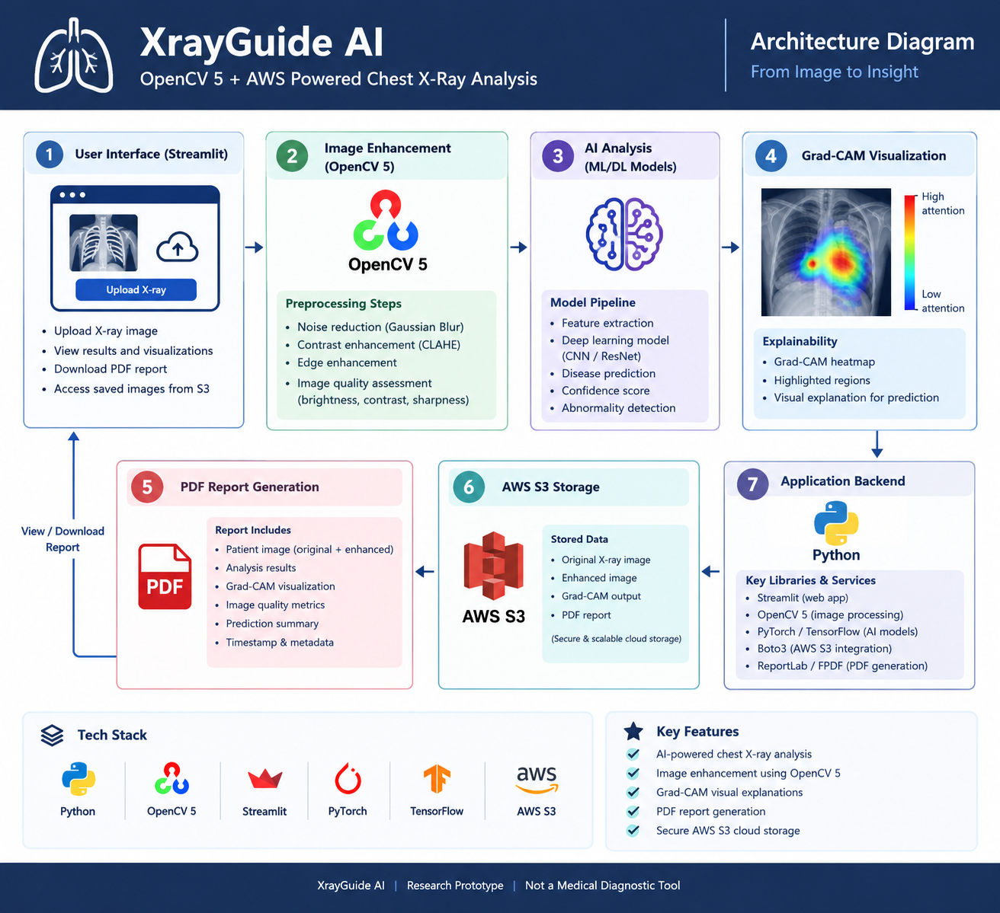

# XrayGuide AI — OpenCV 5 + AWS

**An AI-assisted chest X-ray analysis research prototype combining computer vision, visual explanations, PDF reporting, and cloud storage.**

## Overview

XrayGuide AI is a web application designed to explore chest X-ray images through image enhancement, AI-assisted analysis, visual explanations, and report generation.

The project integrates OpenCV 5 for image-processing workflows and AWS S3 for cloud storage. A Streamlit interface brings these capabilities together in one application.

**Disclaimer:** XrayGuide AI is an experimental research and educational prototype. It is not a validated medical diagnostic tool and must not be used to make clinical decisions.

## Problem Statement

Working with medical images can involve multiple steps, including image preprocessing, analysis, visualization, and documentation. XrayGuide AI demonstrates how these steps can be combined into a single application using computer vision, AI-assisted analysis, and cloud infrastructure.

## Key Features

- **X-ray Image Upload:** Upload a supported chest X-ray image through the web interface.
- **OpenCV 5 Image Enhancement:** Process images to support visual inspection and analysis.
- **AI-Assisted Analysis:** Display findings generated by the configured analysis workflow.
- **Grad-CAM Visualization:** Provide a visual explanation when supported by the underlying model and analysis pipeline.
- **Image Quality Measurements:** Display image intensity and quality-related measurements.
- **PDF Report Generation:** Generate a downloadable report containing available analysis results. Reports are not uploaded to S3.
- **AWS S3 Integration:** Optionally store uploaded original images in a configured private bucket.
- **Streamlit Interface:** Access the workflow through a browser-based application.

## Technology Stack

- Python
- OpenCV 5
- Streamlit
- NumPy
- Pillow
- AI/ML components used by the configured analysis pipeline
- Grad-CAM, where supported by the model
- Amazon Web Services (AWS) S3
- PDF report generation

## System Architecture

XrayGuide AI follows a workflow that connects image upload, image processing, AI-assisted analysis, visualization, report generation, and cloud storage.

### Architecture Diagram



**Workflow:**

1. The user uploads a chest X-ray image through the Streamlit interface.
2. The application processes the image using the configured OpenCV workflow.
3. The original image is passed to the model's preprocessing and inference pipeline; the enhanced image is for visual comparison.
4. The app displays raw model scores, an explanatory text for the highest-scoring label, technical measurements, and an optional Grad-CAM visualization.
5. The user can generate and download a PDF report containing available results.
6. If automatic S3 image sync is enabled and AWS is configured, the original image is stored in the private bucket. PDF reports remain local downloads.

## Project Structure

```text
XrayGuide-AI/
├── app.py                     # Streamlit UI and upload/report workflow
├── s3_storage.py              # S3 client, uploads, and object listing
├── requirements.txt           # Python dependencies
├── config/
│   └── settings.py            # App and image-quality defaults
├── src/
│   ├── agent.py               # Analysis workflow coordinator
│   ├── agent_controller.py    # Rule-based workflow decisions
│   ├── xray_model.py          # TorchXRayVision model loading/inference
│   ├── gradcam.py             # Optional Grad-CAM visualization
│   ├── opencv_processor.py    # CLAHE image enhancement
│   ├── image_quality.py       # Technical image metrics
│   ├── explanation.py         # Label descriptions and caveats
│   ├── pdf_report.py          # PDF generation
│   ├── report_generator.py    # Technical report data helper
│   └── visualization.py       # Prediction chart helper
├── tests/                     # Unit tests and manual S3 connection page
├── docs/                      # Architecture and evaluation notes
├── assets/sample_images/      # Guidance; no medical sample images included
├── deployment/                # Dockerfile and EC2 deployment script
├── .streamlit/config.toml     # Streamlit theme
├── .dockerignore              # Excludes local secrets and dev files from images
└── outputs/                   # Reserved output directory
```

Local `venv/`, `.env`, and `.streamlit/secrets.toml` files are not tracked. Do not put credentials in the repository.

## Installation and Setup

### Prerequisites

- Python version compatible with the project dependencies
- pip
- Git
- AWS credentials and S3 permissions, if cloud storage features are being tested

### 1. Clone the Repository

```bash
git clone https://github.com/Akshaya-126/XrayGuide-AI.git
cd XrayGuide-AI
```

### 2. Create a Virtual Environment

Windows:

```bash
python -m venv venv
venv\Scripts\activate
```

### 3. Install Dependencies

```bash
python -m pip install --upgrade pip
pip install -r requirements.txt
```

### 4. Configure AWS

Set `S3_BUCKET_NAME` and optionally `AWS_REGION` in the process environment or Streamlit secrets. Automatic S3 sync is disabled by default and can be enabled in the app's Settings. Configure AWS credentials through an AWS profile, the standard AWS credential environment variables, or an attached IAM role. The app uses boto3's default credential chain and does not require access keys in Streamlit secrets.

Ensure the configured identity has only the S3 permissions required by the application.

The included `.dockerignore` excludes local credentials and development files from Docker build context. Do not copy secrets into the image or commit AWS access keys, secret keys, API keys, or `.env` files to GitHub. If credentials were ever committed or shared, revoke and rotate them; deleting a local file does not invalidate a key.

For EC2 Docker deployments, attach a least-privilege S3 instance role and export `S3_BUCKET_NAME` (and optionally `AWS_REGION`) before running `deployment/deploy_ec2.sh`; the script passes those non-secret settings into the container. With Docker's default bridge network, ensure the EC2 IMDSv2 response hop limit permits container access to the instance role (commonly 2). Do not expose the instance metadata endpoint publicly.

### 5. Run the Application

```bash
streamlit run app.py
```

Open the local URL displayed in the terminal, usually `http://localhost:8501`.

## Testing Instructions

1. Launch the application.
2. Upload a supported chest X-ray image.
3. Confirm that the image appears correctly.
4. Run the configured image enhancement and AI analysis workflow.
5. Review the available analysis results and image quality measurements.
6. Check the Grad-CAM visualization if successfully generated.
7. Generate and download the PDF report.
8. If automatic S3 image sync is enabled and AWS is configured, verify that the original image is stored. PDF reports are download-only.

Actual results depend on the configured model, available dependencies, input image, and cloud configuration.

## AWS Integration

AWS S3 is used only for uploaded original images and object listing. The PDF report is generated in memory for download and is not stored in S3.

Automatic image sync can be disabled in Settings. For deployment, configure the bucket name, region, and narrowly scoped permissions securely. Keep the bucket private. On EC2, prefer an instance IAM role rather than static credentials.

The “raw score display threshold” only changes score-bar styling. It does not filter predictions or change model inference. The model architecture is fixed to TorchXRayVision DenseNet-121.

## Limitations

- This is an experimental prototype, not a clinically validated system.
- AI-generated findings may be incorrect or incomplete.
- Grad-CAM visualizations are not validated disease-localization evidence.
- Image intensity measurements are not anatomical measurements.
- Cloud storage requires correct AWS configuration and permissions.
- Performance and outputs depend on the actual model and software environment.

## Future Improvements

- Evaluate model performance using appropriate validation datasets and metrics.
- Improve robustness across different X-ray image sources.
- Strengthen error handling and cloud-storage monitoring.
- Improve accessibility and the user interface.
- Expand automated testing and deployment documentation.

## Project Demo

Watch the XrayGuide AI demonstration to see the application workflow, image processing, AI-assisted analysis, visualization, PDF report generation, and AWS integration.

**YouTube Demo:** [Watch the XrayGuide AI Demo](https://youtu.be/6WCkuLyv-ps)

## Project Links

- **GitHub Repository:** [XrayGuide AI](https://github.com/Akshaya-126/XrayGuide-AI)
- **Live Demo:** Add your public Streamlit deployment URL if available.
- **YouTube Video:** Add the published or unlisted demo video URL.

## Author

**Akshaya P.**  
B.E. Computer Science and Engineering, 2027  
Kumaraguru College of Technology

## Acknowledgement

Developed as an experimental project exploring the integration of OpenCV 5, AI-assisted image analysis, and AWS cloud services.

---

**Important:** XrayGuide AI is intended for research and educational exploration only. It must not be used for diagnosis, treatment decisions, or medical triage.
